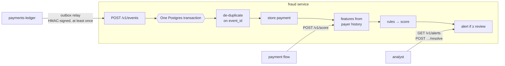

# fraud-detection

[](https://github.com/sillykea/fraud-detection/actions/workflows/ci.yml)

Real-time fraud detection for [payments-ledger](https://github.com/sillykea/payments-ledger), in Go and Postgres. The ledger delivers every posted transaction through its outbox as a signed webhook; this service scores it within milliseconds against the payer's recent behaviour, raises an alert for anything suspicious, and gives analysts a queue to work through. A pre-payment endpoint answers "should this transfer go ahead?" with the same rules before money moves.

What makes it more than a rules file: detection quality is measured. A simulator generates two months of realistic customer traffic with fraud mixed in, and CI fails if recall drops or false positives rise.



## Detection quality

From `cmd/simulate` with seed 1: 300 customers, 30 days of warm-up history, then 30 measured days with 20 cases of each fraud pattern. 32,905 payments.

| Scenario | Cases | Detected | Recall | Fraud payments before first alert (median) | Gated in CI |
|---|---|---|---|---|---|
| Account takeover | 20 | 20 | 100% | 0 | yes |
| Money mule | 20 | 20 | 100% | 0 | yes |
| Fan-out to many new payees | 20 | 20 | 100% | 4 | yes |
| Structuring under 10,000 | 20 | 20 | 100% | 2 | yes |
| Low and slow (one 3–5× payment) | 20 | 0 | 0% | – | no: known blind spot |

16,155 ordinary payments in the measured window, 12 alerted: a **0.074% false positive rate** and **96% alert precision** (280 of 292 alerts were fraud). Every false positive was a customer spending more than 10× their usual at a shop, which is what the `amount_spike` rule is for; a reviewer clears it in seconds.

The ordinary traffic is meant to be awkward: customers spend at different levels, pay rent to the same landlord each month, pay friends, try new shops, and occasionally buy something much bigger. The CI job publishes this table on every run.

**Known blind spots**, on purpose rather than by accident: a single payment a few times larger than usual to a new payee looks exactly like ordinary life, so no rule here catches it. Catching it needs signals this service doesn't see: device, location, session, or a model trained on labelled outcomes. The fan-out rule also lets four payments through before the fifth payee trips it.

## Rules

Each rule that fires adds a score; scores combine as independent evidence, `1 − Π(1 − sᵢ)`, so two weak signals add up but nothing reaches 1 alone. **Review** at 0.5 raises a medium alert; **block** at 0.8 raises a high one.

| Rule | Fires when | Score |
|---|---|---|
| `velocity` | more than 8 payments from the payer in a minute | 0.6 (0.9 at 16+) |
| `fan_out` | 5+ distinct payees in 10 minutes | 0.6 |
| `amount_spike` | 10× the payer's 30-day median, and never paid this payee even half as much | 0.5 (0.75 at 30×) |
| `new_payee_large` | first payment to this payee and over 2,000 | 0.4 |
| `pass_through` | money in from 3+ payers in 30 minutes, 80%+ of it sent straight on | 0.7 |
| `structuring` | 3+ payments in 24 hours within 10% under the 10,000 reporting threshold | 0.7 |

Amounts are integer minor units per currency, so "2,000" means NZ$2,000.00, ¥2,000 or 2,000.000 KWD; each can be overridden per currency. Every threshold is an environment variable. The rules are a pure function of features (`internal/rules`), tested with literals.

## Correctness under a real event stream

| Problem | How it's handled | Proved by |
|---|---|---|
| The ledger delivers an event twice | Event ID recorded in the same transaction as everything else; a redelivery changes nothing | 20 concurrent deliveries of one event: scored once |
| Forged or replayed events | HMAC-SHA256 over a timestamp and the body, 5-minute window, constant-time compare | A fixed test vector shared with the ledger's own tests |
| A burst split across connections or replicas | Scoring takes a per-payer advisory lock, so each payment sees every earlier one | 30 simultaneous payments from one account: exactly the 22 over the limit are flagged, in any order; remove the lock and the test fails |
| Events arriving late or out of order | Windows use the ledger's posting time, not arrival time | A payment arriving an hour late is still judged against its own minute |
| One malformed event blocking the outbox | Authentic but unusable events are acknowledged (202) and kept in `rejected_events` | API test; the e2e job checks none were rejected |
| Two analysts resolving one alert | Conditional update; the second gets 409 with the current state | Detector and API tests |

## API

| Method & path | Auth | What it does |
|---|---|---|
| `POST /v1/events` | `X-Ledger-Signature` | The ledger's webhook. 204 done or duplicate, 202 malformed (not retried), 401 bad signature |
| `POST /v1/score` | Bearer | `{from, to, amount, currency}` → `{decision, score, signals}`, stores nothing |
| `GET /v1/alerts?status=open&account=…&before=…&limit=…` | Bearer | Review queue, newest first, keyset-paginated |
| `GET /v1/alerts/{id}` | Bearer | One alert with its signals and the payment |
| `POST /v1/alerts/{id}/resolve` | Bearer | `{resolution: fraud\|legitimate, note, by}` |
| `PUT/DELETE /v1/trusted-accounts/{id}` | Bearer | Stop or resume scoring an account's outgoing payments (funding, settlement) |
| `GET /metrics`, `/healthz`, `/readyz` | – | Prometheus metrics: events by outcome, rule hits, alerts, open alerts, scoring lag |

```json
{
  "score": 0.85,
  "decision": "block",
  "signals": [
    {"rule": "amount_spike", "score": 0.75, "reason": "3500.00 NZD is 115x the payer's 30-day median of 30.50 NZD"},
    {"rule": "new_payee_large", "score": 0.4, "reason": "first payment to this payee and it is 3500.00 NZD"}
  ]
}
```

## Run it

```sh
make up                # Postgres, this service, and payments-ledger wired to it
make simulate-ledger   # a scripted day of fraud through the real ledger
make simulate          # two months of labelled traffic, prints the table above
make test              # unit and Postgres tests with the race detector
```

## Configuration

| Variable | Default | |
|---|---|---|
| `DATABASE_URL` | required | Postgres connection string |
| `FRAUD_API_TOKEN` | required | Bearer token for `/v1`, 32+ characters |
| `LEDGER_WEBHOOK_SECRET` | required | Same value as the ledger's `OUTBOX_WEBHOOK_SECRET`, 32+ characters |
| `ALLOW_UNSIGNED_EVENTS` | `false` | Local development only |
| `RULE_VELOCITY_PER_MINUTE`, `RULE_FAN_OUT_PAYEES`, `RULE_SPIKE_MULTIPLE`, `RULE_MULE_MIN_PAYERS`, `RULE_STRUCTURING_COUNT` | 8, 5, 10, 3, 3 | Rule thresholds |
| `RULE_LARGE_AMOUNTS`, `RULE_REPORTING_THRESHOLDS` | 2,000 / 10,000 in every currency | Per-currency overrides, e.g. `JPY:300000,NZD:2500` |

## Layout

```
cmd/fraud         the service
cmd/simulate      labelled traffic generator and evaluator (replay and ledger modes)
internal/event    ledger event → payment (skips FX pool legs of conversions)
internal/rules    the rules, as a pure function
internal/detector ingestion, features in SQL, alerts
internal/api      HTTP, signature verification, metrics
internal/sim      traffic generator and scoring of results
docs/adr          design decisions
```

## Design decisions

- [0001 Rules before models](docs/adr/0001-rules-before-models.md)
- [0002 Exactly-once processing on an at-least-once stream](docs/adr/0002-exactly-once-processing.md)
- [0003 Features in Postgres, not in memory](docs/adr/0003-features-in-postgres.md)
- [0004 Measuring detection in CI](docs/adr/0004-measuring-detection.md)

## License

MIT
